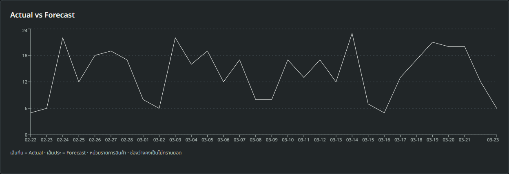

# Coffee-specific dataset evaluation and replay

This extends the existing [forecast plan](forecast-target-spec.md), [dataset addendum](forecast-dataset-addendum.md), [v5 architecture](forecast-v5.md) and [public replay guide](public-dataset-replay.md). The production engine, operational dashboard, recipes, inventory, preparation rules, Mendeley imports/results and old external-model artifacts are retained.

## Assessment and recommendation

Coffee Sales is useful as an **additional coffee-menu demonstration**, with eight recognizable drinks and a longer calendar span. It does not establish better forecasting for a staffed coffee shop. It is a low-volume vending-machine stream; its product demand remains intermittent, and current v5 predictions are weak on several products. Keep both dataset choices and retain the production model. Do not choose or deploy an algorithm because its WAPE happens to look better on a different dataset.

The exact source archive had already been evaluated by this repository's older, relative-demand **28-day** research pipeline. Its checksum is unchanged. This task connects the same verified source to the current isolated research schema and evaluates the **existing v5 methods** under a separately frozen 1/7/30-day rolling protocol. The [old 28-day report](coffee-sales-evaluation.md) and its evaluations/artifacts were not deleted, overwritten or reused as pretrained forecasting weights. This is a new chronological re-evaluation, not a pristine new independent dataset or an untouched confirmation test.

## Source and actual inspection

Selected: [ihelon / Coffee Sales](https://www.kaggle.com/datasets/ihelon/coffee-sales), **version 21**, publisher **Yaroslav Isaienkov**, publisher update **2025-03-25**, license **CC0: Public Domain**. The publisher says the transactions come from their own vending machine. We verified that claim is in the publisher metadata and inspected the downloadable files; we have **not independently audited** the physical machine/business. The source does not describe synthetic generation.

The [alternative](https://www.kaggle.com/datasets/agungpambudi/trends-product-coffee-shop-sales-revenue-dataset) explicitly describes **Maven Roasters as fictional**. It was inspected through publisher metadata and not adopted as evidence of genuine coffee-shop activity.

Pinned archive SHA-256: `e7942082609296f308f459f03f5e3f7da7ee3c5e3be18145eb171c28abf11a56`. Raw ZIP/metadata remain ignored under `.local/public-datasets/ihelon-coffee-sales/`. Detailed source schema/counts/distributions: [coffee-sales-inspection.json](research/coffee-sales-inspection.json).

| Member | Raw rows | Source date coverage | Active dates | Exact duplicate rows | Treatment |
|---|---:|---|---:|---:|---|
| index_1.csv | 3,636 | 2024-03-01–2025-03-23 | 381 | 0 | Primary evaluated stream |
| index_2.csv | 262 | 2025-02-08–2025-03-23 | 41 | 2 | Inspected, excluded; identity/overlap unclear and history short |

The archive contains 3,898 raw rows across two differently shaped files; **3,636** is the adopted primary-stream transaction count. We do not merge them or assume the files are confirmed physical outlets. The replay selector labels `index_1` as a source stream, not a verified store.

Primary columns: `date`, `datetime`, `cash_type`, `card`, `money`, `coffee_name`. The second member lacks `card` and has 30 product labels. There is **no quantity column**, receipt ID, stockout flag, cancellation marker or complete-day closing flag. One primary row means **one recorded vend event**, not independently verified cups or unrestricted demand. Money is never divided by a price to invent quantities.

The primary stream has 89 empty `card` values, corresponding to its 89 cash records; all 3,547 card-payment rows have a marker. These anonymous identifiers are irrelevant and are removed from normalized data, model inputs and inspection artifacts. No missing required primary date/product/money fields, invalid timestamps, nonfinite/negative prices or exact duplicate rows were found. Duplicates in the adopted stream would fail closed for review, not be silently counted or removed.

Daily distribution on the 381 receipt-active source dates: **min 1, max 26, mean 9.5433, median 9, population standard deviation 5.0950** recorded events. Full missing dates are **2024-05-01, 2024-05-04, 2024-05-05, 2024-11-27, 2025-01-01, 2025-01-19, 2025-01-23**. These are unknown coverage, not proven zero-sales days.

## Menu and product demand patterns

Names remain exactly as published. All numbers below describe the complete source for inspection, not features calculated using future test outcomes.

| Drink | Recorded events | Eligible observed dates | Mean/date | Inferred zero dates | CV |
|---|---:|---:|---:|---:|---:|
| Americano | 578 | 381 | 1.517 | 132 | 1.197 |
| Americano with Milk | 824 | 381 | 2.163 | 65 | 0.874 |
| Cappuccino | 501 | 376 | 1.332 | 115 | 0.980 |
| Cocoa | 243 | 381 | 0.638 | 240 | 1.666 |
| Cortado | 292 | 379 | 0.770 | 206 | 1.332 |
| Espresso | 134 | 378 | 0.354 | 274 | 1.838 |
| Hot Chocolate | 282 | 381 | 0.740 | 221 | 1.496 |
| Latte | 782 | 381 | 2.052 | 74 | 0.849 |

An eligible date is a machine-active date on/after the first recorded event for that drink. There are **3,038** normalized product/date observations, including **1,327 inferred zeros**. Zero occurrences on an active date do not prove the drink was available all day. Dates before introduction and full-stream missing dates remain absent. Espresso's low mean and 274 inferred zeros explain why a small unit error can translate to very high percentage error. CV is descriptive variability, not a model-selection criterion introduced after seeing outcomes.

## Preprocessing and reuse

`coffee_sales_dataset.py` reuses the existing `train_external.prepare` source parser, adds complete archive inspection and stricter timestamp checks, and emits the **same normalized format** consumed by `src/research-dataset.ts`. It validates the pinned source version/license/hash. Stable external UUIDs derive from source URL+original drink name. Date strings use the original source calendar; no physical timezone or currency is assumed. Model price input is zero: money, payment type and card markers are excluded.

The existing idempotent importer inserts only `research_datasets` and `research_daily_demand`. Reimporting the prepared file returned `imported:false`. No schema migration or new operational table/API was necessary. Research replay uses the existing authenticated endpoint and append-only `research_replay_runs` / `research_replay_points`. Public source data is never inserted into operational `orders`, payments, stock, closings, cache or forecast archive.

The replay UI now reads target/zero/price semantics from the **selected dataset metadata**, rather than describing every source as Mendeley receipt items. Dataset and source-stream selection work for both imports; old Mendeley rounds and scores remain available. There is no mapping of public drinks to CoffeeBackoffice recipes or stock.

## Fixed evaluation protocol and no future leakage

The protocol and prediction-file checksums are included in [coffee-sales-v5-results.json](research/coffee-sales-v5-results.json). Prediction snapshots are saved under ignored `.local/public-datasets/ihelon-coffee-sales/evaluation/`; the exact input is preserved as `prepared-frozen.json`. Metadata-only display labels can differ from the live import; the observation arrays and all 240 final replay predictions were verified identical between offline evaluation and the live API.

- Last source date: **2025-03-23**. Use a trailing **90-calendar-day** outer evaluation budget, declared before generating the current scores.
- 1 day: **90** chronological origins, targets December 24–March 23. Three target dates are unknown, leaving **87 days / 696 product-day pairs**.
- 7 days: **12** disjoint weekly origins, targets December 30–March 23 (84 calendar days). Three unknown dates leave **81 days / 648 pairs**.
- 30 days: **3** disjoint origins, **2024-12-24, 2025-01-23, 2025-02-22**. Their targets span December 24–March 23, leaving **87 days / 696 pairs**.
- Each cutoff is the first target date. Only earlier observations in the last 180 calendar days are supplied to the engine. A previous outer test outcome can become history only once its date has passed in a later rolling origin; later targets remain withheld.
- Automatic v5 selection retains its own past-only rolling folds, reserved calibration block and fixed XGBoost promotion guards. Hyperparameters and selection thresholds were **not changed** for this dataset or after reading the outer scores.
- Compare Last Value Naive, Matching-weekday Naive, Moving Average 7/28, Weekday Average, SES, direct XGBoost and Automatic v5. Every available candidate sees identical observed targets within its horizon. Unknown outcomes are excluded, not made zero. All candidates had sufficient training in this experiment.
- The runner writes predictions **before** looking up held-out scoring rows. Existing prediction files are never overwritten and must match the frozen protocol/source/engine. Live replay commits immutable prediction rows first, then retrieves actuals.
- Unit tests inject extreme future quantities and confirm all predictions, including native XGBoost, remain unchanged. The production `engine.py` and its model policy were not edited.

## Results: model comparison and product analysis

Full **MAE / RMSE / WAPE / Bias**, for every candidate and horizon, both product/day and daily-total scopes, plus per-drink automatic-method scores: [comparison tables](research/coffee-sales-v5-comparison.md). Machine-readable results: [JSON](research/coffee-sales-v5-results.json).

Automatic v5, pooled rolling results:

| Horizon | Product pairs | Product MAE | Product RMSE | Product WAPE | Product Bias | Total days | Total MAE | Total RMSE | Total WAPE | Total Bias |
|---|---:|---:|---:|---:|---:|---:|---:|---:|---:|---:|
| 1 day | 696 | 1.0989 | 1.5487 | 75.50% | −0.1344 | 87 | 4.1601 | 5.2905 | 35.73% | −1.0755 |
| 7 days | 648 | 1.1258 | 1.5952 | 75.37% | −0.3165 | 81 | 4.6715 | 5.8608 | 39.09% | −2.5322 |
| 30 days | 696 | 1.2167 | 1.6912 | 83.59% | +0.0868 | 87 | 5.0343 | 6.6820 | 43.24% | +0.6943 |

For the 30-day horizon, Weekday Average measured product WAPE **73.42%**, Moving Average 28 **74.59%**, XGBoost **81.73%**, Automatic v5 **83.59%**, and weekly Naive **84.80%**. These are held-out comparisons, not permission to select a winner retrospectively for a claimed prospective result. The current selector did not reliably identify the best eventual candidate on this source. Keep that limitation visible; further selector/model research needs a new protocol and untouched future outcomes.

Product-level 30-day WAPE ranges from **53.79%** for Americano with Milk to **211.13%** for Cortado. Espresso is **124.32%**, and Cocoa **113.16%**. Low/intermittent quantities make percentage errors severe; MAE, signed Bias and sample counts are necessary alongside WAPE. Automatic total Bias is small after pooling, but absolute day-to-day errors are substantial. Aggregating drinks can cancel over/under predictions and is not evidence of accurate ingredient-level demand.

## Fixed presentation replay versus pooled rolling experiment

The default demonstration uses **2025-02-22–2025-03-23**, one 30-day holdout, training through **2025-02-21**. Saved run/checksum and results: [coffee-sales-demo-results.json](research/coffee-sales-demo-results.json).

| Scope | Samples | MAE | RMSE | WAPE | Bias |
|---|---:|---:|---:|---:|---:|---:|
| Product/day | 240 | 1.333342 | 1.762934 | 76.5555% | +0.606458 |
| Selected-drink total/day | 30 | 5.899667 | 7.483374 | 42.3421% | +4.851667 |

These differ from the **three-window pooled** 30-day scores because the target populations differ. The live API's 240 predictions match the frozen offline final-window automatic predictions exactly; the UI has not been given different forecasts or manually improved scores.

Actual vs Forecast on the application, daily total of the selected eight drinks:



Solid = recorded Actual, dashed = saved Forecast. This is a retrospective vending-machine evaluation, not a prediction issued in 2025 or genuine-shop prospective accuracy. Product results and inferred-zero flags remain available in the daily table.

## Comparison with the retained Mendeley result

| Dataset / experiment | Product scope | Product-day WAPE | Daily-total WAPE |
|---|---|---:|---:|
| Mendeley SHOP001, September 2025, one fixed 30-day window | 94 products, 2,820 pairs | 80.91% | 9.35% |
| Coffee Sales index_1, final fixed 30-day window | 8 drinks, 240 pairs | 76.56% | 42.34% |
| Coffee Sales index_1, pooled three 30-day rolling windows | 8 drinks, 696 pairs | 83.59% | 43.24% |

**Cross-dataset WAPE is not evidence of algorithm improvement or degradation.** Source business, recorded unit semantics, volume, number of products, intermittency, dates and validation populations differ. A smaller product WAPE in one row does not establish a better model, and the 94-product aggregate can cancel more item errors. Within-dataset method comparisons on identical pairs are the relevant experimental evidence. None of these rows establishes accuracy for an untested operational CoffeeBackoffice shop.

## Run the presentation

This machine already has both imports and saved replays. Start `npm run local:lan`, sign in as owner/manager and open **พยากรณ์ → Historical Replay** or `http://localhost:3001/forecast/replay`.

1. Select **Coffee Sales — ihelon · V21**.
2. Select **index_1** (source stream; physical outlet is unknown).
3. Select all drinks or a specific original product.
4. Set first test day **2025-02-22**, horizon **30 days**, history **180 days**, then start Replay. Training ends February 21. Choose 1 or 7 days to show other supported horizons.
5. Show product/day metrics, the actual/forecast graph, daily results/unknown-zero labels, and the separate total-day score disclosure. Explain that selection diagnostics were computed inside the earlier training period, not on the displayed outcomes.
6. Download JSON to show dataset ID, source, actual execution timestamp, simulated cutoff, input checksum and immutable predictions. Select a saved round to reopen it without refitting. Internet is not needed after import.
7. Switch back to **Anonymous Transactional Dataset V2** to show that previous results are retained. Return to **พยากรณ์ร้าน** for the existing synthetic end-to-end and recipe/stock demonstration. Do not imply public vending products have the shop's recipes.

Fresh-machine / offline reproduction (use the installed project Python environment):

```powershell
.venv/Scripts/python.exe forecast-service/coffee_sales_dataset.py --download
npm run dataset:import -- .local/public-datasets/ihelon-coffee-sales/prepared.json
.venv/Scripts/python.exe forecast-service/evaluate_research.py --prepared .local/public-datasets/ihelon-coffee-sales/prepared.json --output .local/public-datasets/ihelon-coffee-sales/new-evaluation
npm run local:lan
```

If Kaggle access is unavailable, put the unmodified version-21 ZIP at `.local/public-datasets/ihelon-coffee-sales/original.zip` and publisher metadata at `metadata.json`, then run the adapter without `--download`. It verifies the pinned hash/license/version. The original completed experiment can be resumed/re-scored with `--prepared .local/public-datasets/ihelon-coffee-sales/evaluation/prepared-frozen.json --output .local/public-datasets/ihelon-coffee-sales/evaluation`; changed engine/protocol/input is refused. Frozen results avoid interpreting numerical refit differences across OS/builds as research improvement.

## Verification and changed files

Passed: **51 Python tests**, **101 PostgreSQL tests**, **101 PGlite tests**, typecheck/build, strict UI audit, Coffee Sales desktop/mobile WCAG/keyboard/failure/retry/export/archive checks, the existing Mendeley replay browser check, and all **27 whole-app browser workflow groups** (POS/KDS/orders/payments/recipes/inventory/reports/roles/QR). Importing twice was idempotent. Browser checks assert unchanged orders/payments/stock movements/closings/operational forecast counts and stock rows. Offline/live parity covered all 240 final-window predictions. No production model, operational schema, recipe rule, inventory rule or earlier result was changed.

| Files | Purpose |
|---|---|
| `forecast-service/coffee_sales_dataset.py`, `test_coffee_sales_dataset.py` | Reusable source adapter and inspection/normalization tests; reuse the original parser |
| `forecast-service/evaluate_research.py`, `test_evaluate_research.py` | Frozen rolling experiment and all-candidate future-exclusion/metrics tests |
| `client/pages/HistoricalReplay.tsx` | Dataset-specific target/price/zero explanations and source-stream label |
| `scripts/check-public-replay.mjs`, `package.json` | Parameterized coffee/Mendeley browser checks and prepare/evaluate commands |
| `docs/research/coffee-sales-*`, this report, README/DESIGN/UX contract | Source inspection, complete tables, frozen protocol/results, figure and presentation guide |

Still needed for reliable shop decisions: genuine prospective shop outcomes, better evaluation of intermittent product demand, and independent validation of any proposed selector/model change. There is no basis here to claim high menu-level accuracy or automatic operational deployment approval.
