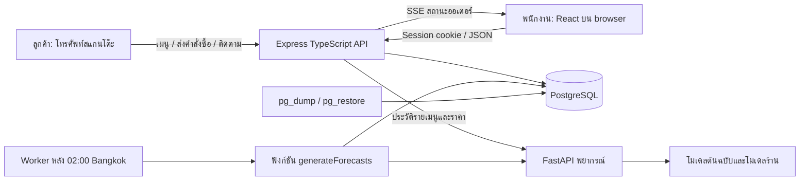
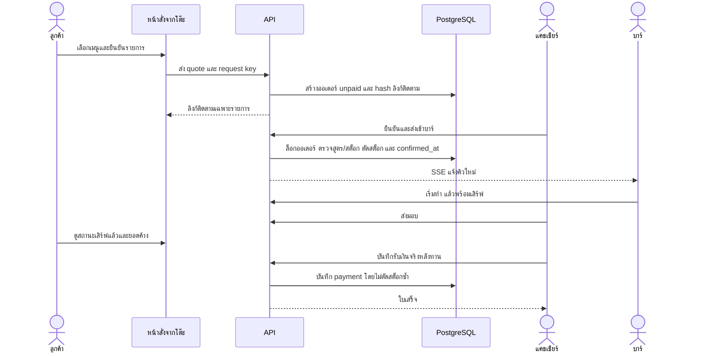
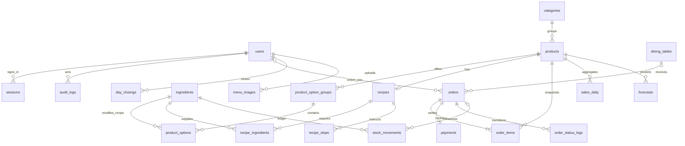

# โครงสร้างระบบ Coffee Backoffice

เอกสารอธิบายระบบที่พัฒนาอยู่ใน repository นี้ ขอบเขตร้านเดียว ไม่ได้อ้างว่าเป็นผลการทดลองกับร้านหรือกลุ่มผู้ใช้จริง เอกสารต้นทางเป็นข้อกำหนดผลิตภัณฑ์ ส่วนการอนุญาตดำเนินงานมาจากผู้ใช้

## ปัญหาและวัตถุประสงค์

ลดการส่งรายการซ้ำระหว่างรับออเดอร์ บาร์ และแคชเชียร์ เก็บสูตร/ยอดสต็อกในที่เดียว เชื่อมรายการรับเงินกับรายงาน และใช้ประวัติยอดขายเพื่อเสนอปริมาณเตรียม/วัตถุดิบ พิสูจน์การทำงานด้วยการทดสอบ transaction, สิทธิ์, เครือข่ายขัดข้อง และกระบวนการขายครบวงจร ความแม่นยำพยากรณ์ต้องวัดแยกด้วยข้อมูลอนาคตของร้าน

## สถาปัตยกรรม

Frontend build เสิร์ฟจาก origin เดียวกับ API; development ใช้ Vite proxy ได้ Browser ไม่เชื่อมฐานข้อมูลหรือบริการพยากรณ์โดยตรง ผลพยากรณ์บันทึกใน DB ก่อนหน้าเว็บอ่าน Scheduler ใช้ advisory lock กัน worker ซ้อน และมี run_date กันการทำสำเร็จซ้ำวันเดิม

## ผู้ใช้และกรณีใช้งาน

| ผู้ใช้  | งานหลัก                                                               | ขอบเขตที่แยกไว้                          |
| ------- | --------------------------------------------------------------------- | ---------------------------------------- |
| ลูกค้า  | ดูเมนู สั่งจากโต๊ะ ติดตามรายการของตน                                  | ไม่มี staff session/รายการลูกค้าคนอื่น   |
| cashier | POS ตรวจ/ยืนยัน QR รับเงินจริง ส่งมอบ พิมพ์ใบเสร็จ                    | ไม่มีจัดการต้นทุน/บัญชีผู้ใช้            |
| kitchen | KDS สูตร เริ่มทำ/พร้อมเสิร์ฟ                                          | ไม่มีข้อมูลเงินหรือรายงาน                |
| manager | เมนู รูป สูตร สต็อก โต๊ะ รายงาน/ปิดวัน พยากรณ์ จัดการ cashier/kitchen | ไม่จัดการ owner/manager หรือดูกำไร owner |
| owner   | งานทั้งหมด กำไร ผู้ใช้ audit API                                      | ลดสิทธิ์ตนเอง/ลบ owner สุดท้ายไม่ได้     |

## ลำดับการสั่งและจ่ายหลังทาน

สถานะการทำ `pending → preparing → ready → completed` แยกจากการชำระ การยืนยันร้านเป็นเงื่อนไขเข้า KDS ไม่ใช่การรับเงิน การส่งมอบจึงสำเร็จได้ก่อนรับเงิน รายการเสิร์ฟแล้วแต่ค้างจ่ายยังนับในคิวเงินค้างและขวางปิดวัน ยกเลิกก่อนเริ่มทำคืน stock ที่เคยตัด; หลังเริ่มทำไม่คืนอัตโนมัติ การคืนเงินที่จ่ายแล้วต้อง manager/owner ยืนยันว่าคืนเงินจริง

## ER diagram

Diagram แสดงความสัมพันธ์หลัก ไม่แสดง FK ของผู้ยืนยัน/ผู้บันทึกซ้ำทุกเส้น Schema SQL ใน `migrations/` เป็นแหล่งข้อมูลรายละเอียดจริง รูปผูกกับ products ผ่าน URL content hash ไม่ใช่ FK เพื่อรองรับทั้งรูปใน bundle และ HTTPS ภายนอก

## พจนานุกรมข้อมูลระดับตาราง

| ตาราง                                   | คีย์/ข้อมูลสำคัญ                                                             | หน้าที่และข้อกำหนด                        |
| --------------------------------------- | ---------------------------------------------------------------------------- | ----------------------------------------- |
| users                                   | UUID, email unique, password_hash, role, is_active                           | bcrypt, ไม่มีรหัสผ่านใน API               |
| sessions                                | token_hash PK, user_id, expires_at                                           | เก็บเฉพาะ hash, cookie HttpOnly           |
| audit_logs                              | identity id, actor_id, action, entity UUID, details                          | บันทึกเหตุการณ์เปลี่ยนข้อมูล              |
| categories                              | UUID, name, sort_order                                                       | หมวดเมนู                                  |
| products                                | UUID, category_id, price_satang, image_url, station, version, forecast_since | archive แทนลบประวัติ                      |
| product_option_groups / product_options | UUID, parent FK, ราคาเพิ่ม, วัตถุดิบเพิ่ม/ทดแทน                              | ตรวจ required/multi-select และสูตร        |
| recipes                                 | product_id PK/FK, version                                                    | สูตรหลักของเมนู                           |
| recipe_ingredients / recipe_steps       | product FK, ingredient FK หรือ step_no                                       | ปริมาณฐาน, ขั้นตอน/เวลา/รูป               |
| ingredients                             | UUID, unit, numeric stock/reorder/cost, version                              | stock ไม่ติดลบ, ทศนิยมตามหน่วย            |
| orders                                  | UUID, order_no, type, status, source, confirmation, request key/hash         | snapshot/idempotency และแยก POS/QR        |
| order_items                             | UUID, order_id, product_id, ชื่อ/ราคา/options/สูตร snapshot                  | เปลี่ยนเมนูไม่เปลี่ยนประวัติเดิม          |
| payments                                | order_id PK, amount_satang, method, status, paid_at, ผู้ยืนยัน               | หนึ่ง payment ต่อ order; satang integer   |
| order_status_logs                       | identity id, order_id, from/to status, actor/time                            | ประวัติการทำและเวลาเตรียม                 |
| stock_movements                         | UUID, ingredient, qty, balance_after, reason, order ref                      | บัญชีรับเข้า/ใช้/คืน/เสีย                 |
| day_closings                            | date PK, closed_by, summary                                                  | วันปิดแล้วคงสรุปและขวางแก้เงินย้อนหลัง    |
| sales_daily                             | date/product/source compound unique, qty/revenue                             | แยก actual/demo ไม่ผสมเป็นยอดเงินจริง     |
| forecasts                               | UUID, date/product unique, point/bounds, version/source/generated_at         | bounds เป็นคู่ nullable; ไม่สร้างช่วงปลอม |
| forecast_jobs                           | run_date PK, model_version, completed_at                                     | สำเร็จวันละครั้งหลัง 02:00                |
| dining_tables                           | UUID, name unique, qr_token, active, version                                 | เปลี่ยน QR/ปิดรับรายการใหม่               |
| menu_images                             | UUID unique, SHA-256 PK, bytea, width/height, creator                        | รูป WebP สาธารณะ, backup ใน DB            |
| schema_migrations                       | name PK, checksum, applied_at                                                | migrations ที่ใช้แล้วแก้ไม่ได้            |

## API และการป้องกันข้อมูล

| กลุ่ม       | เส้นทางหลัก                                                    | การควบคุม                                                      |
| ----------- | -------------------------------------------------------------- | -------------------------------------------------------------- |
| Session     | `/api/auth/*`                                                  | rate limit, Origin, cookie/session expiry                      |
| ผู้ใช้      | `/api/users`                                                   | owner/manager ตาม target role                                  |
| เมนู        | `/api/catalog`, `/api/products`, `/api/categories`             | catalog สำหรับขาย, เขียน owner/manager                         |
| รูป         | `POST /api/menu-images`, `GET /api/menu-images/:hash.webp`     | upload owner/manager; GET public image bytes เท่านั้น          |
| สูตร/สต็อก  | `/api/ingredients`, `/api/recipes/:id`, `/api/stock-movements` | role/version, SQL transaction                                  |
| ออเดอร์     | `/api/orders`, `/api/kds`, `/api/events`                       | role และ transition; แยก kitchen จากเงิน                       |
| รายงาน      | `/api/reports`, `/api/reports/close`, `/api/audit-logs`        | manager/owner; กำไร/audit เฉพาะ owner                          |
| พยากรณ์     | `/api/forecasts`, `/api/forecasts/generate`                    | manager/owner, ช่วงวัน/เมนูตรวจบน server                       |
| ลูกค้า/โต๊ะ | `/api/guest/*`, `/api/tables`                                  | table capability/public whitelist; โต๊ะจัดการโดย manager/owner |

ทุก staff mutation ตรวจ Origin; SQL ใช้ parameters; session/guest tracking เก็บ hash; public tracking ไม่เปิดรายการออเดอร์ทั้งหมด ราคาและสูตรคิดจาก server ไม่เชื่อราคาที่ client ส่งมา CSP/Helmet ป้องกัน browser ตาม environment ควบคู่ HTTPS ใน production สิทธิ์ตรวจบน server ทุกครั้ง รูปผ่าน decoder และลบ metadata; ไม่รับ SVG/HTML เป็นรูป

## ขอบเขตที่ยังต้องพิสูจน์นอกเครื่องพัฒนา

ไม่มีหลักฐานการใช้งานจากร้านจริง/ผลประเมินผู้ใช้จริง จนกว่าจะเก็บตาม acceptance plan ไม่มีข้อมูล hardware printer, gateway, IoT, domain หรือ production host ที่ระบุไว้ จึงไม่อ้างว่าเชื่อมอุปกรณ์/บริการเหล่านั้นแล้ว ไม่รวมสมาชิก/แต้ม/หลายสาขาในขอบเขตปัจจุบัน
